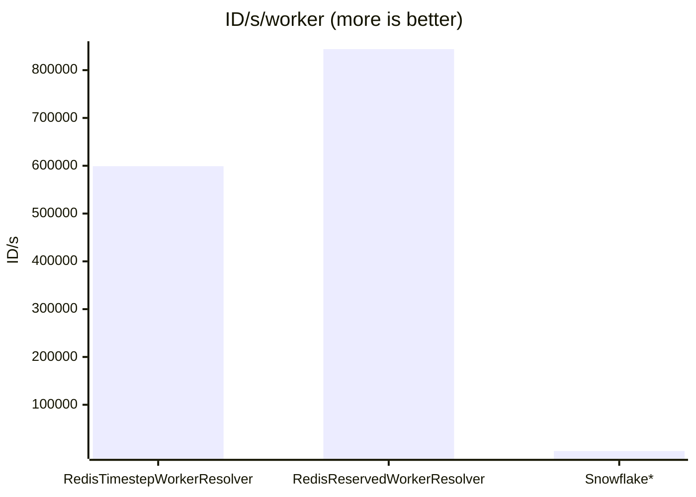

## Benchmarks

For best performance, make sure you don't have loaded debugging or code coverage extensions like xdebug, pcov or make
sure they are turned off.
For signing, use the fastest hash when possible, e.g. SiphashHMAC (requires sodium or flexid_utils extension).

For ultimate performance, use flexid_utils extension. It can achieve 8-40x better results for:
CustomSerializer, BaseSerializer, HashSerializer, Sparx64Encrypter and Sparx128Encrypter.
These classes automatically uses extension if available and have fallback to PHP implementation if not.

### Unique ID generation with Redis
This implementation provide performance benefits especially when generating lots of IDs. Below are results from 1
generator generating 10k IDs with id() method, 0.2ms Redis round trip was applied to simulate typical cloud latency.

\* Implementation of Snowflake from godruoyi/php-snowflake package with RedisSequenceResolver for uniqueness - 
1 request for each ID. With 1 id generation per request this will flat out as every generator have to ping redis on each id.

### Other tools performance

**PHP 8.5.11, no opcache**

Test with 10k operations:| without flexid extension | with flexid extension
-|--------------------------|-
FlexIdGenerator with StaticWorkerResolver        | 4,281,033 ops/s          |4,466,315 ops/s
FlexIdGenerator with RandomWorkerResolver        | 2,045,475 ops/s          |2,359,001 ops/s
BaseSerializer serialize                         | 1,652,554 ops/s          |8,552,418 ops/s
BaseSerializer deserialize                       | 1,207,243 ops/s          |9,539,873 ops/s
CustomSerializer serialize                       | 714,438 ops/s            |7,327,355 ops/s
CustomSerializer deserialize                     | 768,319 ops/s            |8,317,585 ops/s
HashSerializer serialize                         | 1,083,244 ops/s          |7,343,902 ops/s
HashSerializer deserialize                       | 1,425,161 ops/s          |7,219,810 ops/s
HexSerializer serialize                          | 8,891,054 ops/s          |9,088,017 ops/s
HexSerializer deserialize                        | 6,785,982 ops/s          |6,909,298 ops/s
Base64Serializer serialize                       | 4,837,986 ops/s          |5,066,934 ops/s
Base64Serializer deserialize                     | 4,678,581 ops/s          |4,747,817 ops/s
Sparx64Encrypter encrypt                         | 252,806 ops/s            |4,098,156 ops/s
Sparx64Encrypter decrypt                         | 229,610 ops/s            |3,817,448 ops/s
Sparx64Encrypter encrypt (+sign siphash-2-4)     | 217,775 ops/s            |1,888,541 ops/s
Sparx64Encrypter decrypt (+sign siphash-2-4)     | 208,710 ops/s            |1,395,155 ops/s
Sparx128Encrypter encrypt (+sign siphash-2-4)    | 81,746 ops/s             |1,602,023 ops/s
Sparx128Encrypter decrypt (+sign siphash-2-4)    | 77,470 ops/s             |1,308,199 ops/s
Sparx128TurboEncrypter encrypt (+sign siphash-2-4)|-                        |2,440,689 ops/s
Sparx128TurboEncrypter decrypt (+sign siphash-2-4)|-                        |2,026,600 ops/s
AesEncrypter encrypt (+sign siphash-2-4)         | 435,653 ops/s            |625,755 ops/s
AesEncrypter decrypt (+sign siphash-2-4)         | 372,302 ops/s            |590,805 ops/s
XChaCha20Encrypter encrypt (+sign Poly1305)      | 1,154,302 ops/s          |1,147,346 ops/s
XChaCha20Encrypter decrypt (+sign Poly1305)      | 1,194,318 ops/s          |1,188,754 ops/s
Signer (BaseSerializer) sign siphash-2-4         | 1,300,579 ops/s          |2,673,275 ops/s
Signer (BaseSerializer) verify siphash-2-4       | 1,136,945 ops/s          |1,856,741 ops/s
SiphashHMAC sign                                 | 3,661,067 ops/s          |7,928,831 ops/s
Blake3HMACFlexIdExt sign                         | -                        |4,886,291 ops/s
Blake2HMACSodiumExt sign                         | 1,608,516 ops/s          |1,661,030 ops/s
Sha256HMAC sign                                  | 929,034 ops/s            |952,938 ops/s

See also [raw dumps](../src/Scripts/RefPerf/perf6.0.txt)

For comparison Sqids package (functionally similar to HashSerializer - short, random-looking id):

Test with 10k operations:| ops/s
-|-
Sqids v0.5 serialize                              | 151,610 ops/s
Sqids v0.5 deserialize                            | 341,227 ops/s
